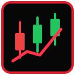

<div align="center">



# BOLSA SIMULADA SV

### El mercado que nunca duerme.

https://bolsa-simulada.vercel.app

Una terminal bursátil con empresas ficticias salvadoreñas, precios que se mueven
en vivo y operaciones de compra y venta. Todo se crea, edita y conserva en una
base de datos **SQLite real** que vive dentro de tu navegador.

<br />


</div>

---

## Cómo funciona

**Bolsa Simulada SV** es una bolsa de valores de mentira. Tienes **USD 10,000.00 virtuales**, ocho empresas inventadas cuyo precio cambia solo cada 2 segundos, y puedes comprar y vender acciones para ganar o perder dinero. También puedes **lanzar tus propias empresas** a la bolsa.

### Prueba rápida de 2 minutos

1. **Abre el sitio.** Verás una intro de terminal (clic o cualquier tecla para saltarla) y la pantalla principal con todo visible: empresas, gráfico, noticias, ticket de orden, formulario de empresa, portafolio e historial.
2. **Crear (C).** En el panel derecho, en **Lanzar empresa (IPO)**, escribe un ticker de 2 a 5 letras mayúsculas, un nombre, un sector, un precio inicial y una volatilidad. Pulsa **Lanzar empresa**: aparece en la tabla de empresas.
3. **Leer (R).** Haz clic en cualquier fila de la tabla para ver su gráfico de precios en vivo y operar con ella.
4. **Actualizar (U).** Pulsa **Editar** en la fila de tu empresa, cambia un dato y guarda. En el ticket de orden elige **Comprar** o **Vender**, escribe una cantidad y ejecuta: tu efectivo y tu portafolio cambian al instante.
5. **Eliminar (D).** Pulsa **Eliminar** en la fila de una empresa y confirma. Sale de la bolsa; si tenías acciones, se liquidan al último precio y la venta queda registrada.
6. **Recarga la página (F5).** Tus empresas, tus compras, tu efectivo y tu historial siguen exactamente donde los dejaste.

### Por qué los datos no se pierden al recargar

La base de datos es **SQLite compilado a WebAssembly** (`sql.js`). Después de cada cambio, la aplicación guarda la base completa en **IndexedDB**, un almacenamiento permanente del navegador, y también la guarda al ocultar o cerrar la pestaña. Al volver a abrir el sitio, la base se recupera tal como estaba.

| Acción | ¿Borra tus datos? |
| --- | --- |
| Recargar la página (F5) | No |
| Cerrar y volver a abrir la pestaña o el navegador | No |
| Comprar, vender, crear, editar o eliminar empresas | No, se guardan |
| Botón **Reiniciar simulación** (pide confirmación) | **Sí**, vuelve a los datos iniciales |
| Abrir el sitio en otro navegador, otro dispositivo o una ventana nueva sin historial | Empiezas con los datos iniciales |

> Los datos pertenecen a **tu navegador**: no hay servidor ni cuentas, así que cada visitante tiene su propia bolsa. Esto es intencional y lo que mantiene el sitio rápido y estable.

### Qué cubre cada criterio del laboratorio

| Criterio | Dónde verlo |
| --- | --- |
| Sitio en línea | Esta URL abre directo en la terminal, sin pasos previos |
| SQLite funcional con CRUD y persistencia | Crear, editar y eliminar empresas en la pantalla principal, y recargar para comprobar que persisten |
| Creatividad | Una terminal bursátil estilo Bloomberg, con mercado vivo, noticias aleatorias y empresas salvadoreñas inventadas |
| Interfaz usable | Franja de ayuda de 3 pasos, todo visible a la vez, botones etiquetados, diseño responsive y consola sin errores |
| GitHub coherente | Repositorio público, historial de commits y este README |

---

## Descripción

**Bolsa Simulada SV** está construida con **Vite + TypeScript vanilla** y una arquitectura **MVC** sin frameworks de interfaz. La terminal se presenta con fondo oscuro, acentos rojos y tipografía monoespaciada: los precios suben en verde y bajan en rojo, hay una cinta de precios en movimiento y noticias de mercado que impactan en las cotizaciones.

La persistencia es local y real: `sql.js` ejecuta SQLite compilado a WebAssembly y el binario completo de la base de datos se guarda en IndexedDB después de cada escritura. No hay servidor, no hay cuentas y no hay dependencias de red para que la bolsa funcione.

---

## Características principales

### Terminal de mercado en vivo

- Terminal de una sola pantalla con empresas, gráfico de precios, noticias, ticket de orden, formulario de emisión, portafolio e historial de operaciones.
- Motor de mercado activo cada 2 segundos con paseo aleatorio, volatilidad por empresa y reversión a la media.
- Noticias aleatorias que mueven el precio de una empresa y quedan registradas en el feed.
- Cinta de precios en movimiento continuo y gráfico de área con el historial de la empresa seleccionada.

### Trading

- Compra y venta de acciones con validación de efectivo, cantidad y posición disponible.
- Portafolio con cantidad, costo promedio, valor actual y ganancia o pérdida.
- Historial de operaciones que conserva el ticker aunque la empresa se elimine.

### Mercado administrable (CRUD completo)

- **Crear:** lanzar una empresa nueva (IPO) con ticker único, nombre, sector, precio y volatilidad.
- **Leer:** tabla de empresas, gráfico, portafolio, historial y noticias.
- **Actualizar:** editar los datos de una empresa y actualizar precios en cada tick.
- **Eliminar:** sacar una empresa de bolsa liquidando las acciones del usuario al último precio.

### Identidad visual

- Tema de terminal negra con acentos rojos, sin emojis, sin fuentes externas y sin CDN.
- Intro de arranque de 1.85 segundos, saltable y visible una sola vez por sesión.
- Diseño responsive: escritorio en tres columnas y móvil en una sola columna.

---

## Stack tecnológico

| Tecnología | Uso |
| --- | --- |
| **Vite** | Servidor de desarrollo y empaquetado |
| **TypeScript** | Tipado estricto de modelos, vistas y controladores |
| **sql.js** | SQLite compilado a WebAssembly |
| **IndexedDB** | Persistencia del binario exportado de SQLite |
| **lightweight-charts** | Gráfico de precios |
| **CSS** | Diseño de terminal, animaciones y puntos de quiebre |
| **GitHub + Vercel** | Control de versiones y despliegue continuo |

---

## Arquitectura MVC

```text
bolsa-simulada-sv/
  index.html
  package.json
  vite.config.ts
  tsconfig.json
  README.md
  .gitignore
  public/
    favicon.ico
    favicon.svg
  src/
    main.ts
    db/
      database.ts
    models/
      types.ts
      validation.ts
      company.ts
      trading.ts
      market.ts
      news.ts
    views/
      format.ts
      chart.ts
      notifications.ts
      terminalView.ts
    controllers/
      terminalController.ts
    styles/
      styles.css
```

> La vista nunca habla con la base de datos: todo pasa por el controlador y los modelos.

### Flujo de una operación

1. El usuario pulsa **Ejecutar compra** en la vista.
2. El controlador recoge los datos y los entrega al modelo de operaciones.
3. El modelo valida la cantidad, el efectivo y el precio, y escribe en SQLite dentro de una transacción.
4. `database.ts` programa el guardado del binario en IndexedDB.
5. El controlador pide los datos actualizados y la vista redibuja solo lo que cambió.

### Responsabilidades

- `src/db/database.ts`: inicialización de sql.js, esquema, datos semilla, transacciones y persistencia en IndexedDB.
- `src/models/`: reglas de negocio de empresas, mercado, noticias, operaciones y validaciones.
- `src/views/`: construcción del DOM, formato de números, gráfico, diálogos, toasts e intro.
- `src/controllers/terminalController.ts`: coordinación entre modelos y vistas, intervalo del mercado y acciones del usuario.
- `src/styles/styles.css`: tema visual, animaciones, estados y puntos de quiebre.

---

## Base de datos

### Esquema

El esquema se crea automáticamente la primera vez que se abre la aplicación.

| Tabla | Contenido |
| --- | --- |
| `companies` | Empresas que cotizan: ticker único, nombre, sector, precio, cierre anterior y volatilidad |
| `price_history` | Puntos de precio por empresa, máximo 500 por empresa |
| `holdings` | Cantidad y costo promedio de las acciones del usuario |
| `trades` | Historial de compras y ventas; conserva el ticker aunque la empresa se elimine |
| `account` | Efectivo disponible y efectivo inicial; solo existe una cuenta |
| `news` | Noticias generadas con su impacto y fecha |

### Seed inicial

La primera vez se cargan **8 empresas ficticias** con 120 puntos de historial cada una, **USD 10,000.00** de efectivo y noticias iniciales, para que los gráficos nunca aparezcan vacíos.

### Persistencia

`database.ts` exporta la base con `db.export()` y guarda el binario en IndexedDB con un debounce de 700 ms después de cada escritura. En el arranque:

- Si hay un registro guardado, se carga con `new SQL.Database(bytes)`.
- Si no existe, se crea la base y se ejecutan el esquema y los datos semilla.
- Si IndexedDB no está disponible, la aplicación continúa en memoria y no muestra errores en consola.

### Consultas

Las operaciones que tocan varias tablas se ejecutan dentro de **transacciones** de SQLite, y todas las consultas usan parámetros en lugar de concatenar texto.

---

## Motor de mercado

- Cada 2 segundos se actualiza el precio de todas las empresas.
- El cambio combina un choque aleatorio proporcional a la volatilidad con una fuerza de reversión hacia el cierre anterior.
- El precio nunca baja de USD 0.50 y se redondea a dos decimales.
- En cada tick hay un 5% de probabilidad de noticia: mueve el precio de una empresa entre 3% y 8%, se guarda y aparece en el feed.
- Cada actualización agrega un punto al historial y recorta los más antiguos.
- La base se guarda cada 10 ticks y también al ocultar o cerrar la página.

### Validaciones

- El ticker debe tener entre 2 y 5 letras mayúsculas, sin números ni símbolos, y no puede repetirse.
- El nombre es obligatorio y el precio inicial debe ser mayor que cero.
- La volatilidad debe estar entre 0.1% y 8%.
- La cantidad de una orden debe ser un entero mayor o igual a 1.
- No se puede comprar sin efectivo suficiente ni vender más acciones de las que se poseen.

Los errores se muestran junto al formulario o al ticket y también como aviso (toast).

---

## Instalación local

Requisitos: **Node.js 20+**, **npm 10+** y un navegador moderno con WebAssembly e IndexedDB.

```bash
git clone https://github.com/CarlosGranados-devs/Bolsa-simulada.git
cd Bolsa-simulada
npm install
npm run dev
```

Vite publica el sitio en `http://localhost:5173`.

### Scripts disponibles

| Script | Descripción |
| --- | --- |
| `npm run dev` | Servidor de desarrollo con recarga en caliente |
| `npm run build` | Comprueba los tipos con `tsc` y genera `dist/` |
| `npm run preview` | Sirve la versión de producción localmente |

---

## Build de producción

```bash
npm run build
npm run preview
```

La compilación genera la carpeta `dist/` con el HTML, los estilos, el JavaScript y el archivo `sql-wasm.wasm` necesarios para ejecutar la aplicación.

---

## Despliegue en Vercel

### Desde el panel

1. Importa el repositorio en Vercel.
2. Selecciona el framework **Vite**.
3. Usa `npm run build` como comando de compilación y `dist` como directorio de salida.
4. Pulsa **Deploy**. No se necesitan variables de entorno.

### Por qué es estático

La base de datos vive en el navegador, así que no hay funciones serverless, ni sistema de archivos que escribir, ni servicios externos que puedan fallar. Cada `git push` a `main` despliega una nueva versión automáticamente.

---

## Accesibilidad y detalles de ingeniería

- `lang="es"`, etiquetas en todos los formularios, foco visible y enlace de salto.
- Regiones con `aria-live` para precios, noticias y avisos.
- Confirmaciones propias con `<dialog>` y avisos tipo toast, sin `alert`, `confirm` ni `prompt`.
- Sin emojis, sin fuentes externas y sin CDN.
- Consola del navegador sin errores ni advertencias.

---

## Estado del proyecto

- [x] SQLite funcional con CRUD completo y persistencia
- [x] Motor de mercado, noticias y gráfico en vivo
- [x] Compra y venta con portafolio e historial
- [x] Diseño responsive para móvil y escritorio
- [x] Desplegado en Vercel desde GitHub

---

## Datos ficticios

Las empresas, tickers, precios, noticias y movimientos de este simulador son inventados y se usan solo con fines académicos y demostrativos. No representan valores reales ni constituyen asesoría financiera.

---

<<<<<<< HEAD
Carlos Josue Manajo Granados
=======
**Carlos Josue Manajo Granados** · Laboratorio 3 · Proyecto Creativo
>>>>>>> 9b15525 (add readme y logo svg)
